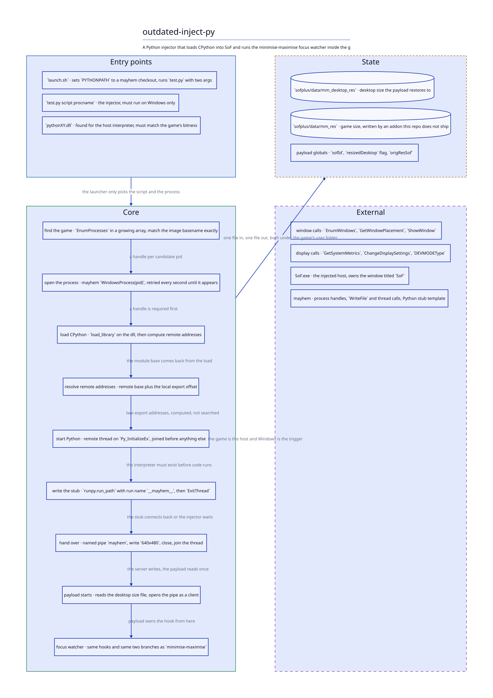

# outdated-inject-py

An abandoned attempt to move the `minimise-maximise` focus watcher *inside* SoF: a small launcher runs a mayhem-based Python injector, which loads CPython into the game process and executes the watcher there instead of in a separate exe.

Read it left to right:

- **It is the same watcher, one process closer.** `script.py` is `minimise-maximise`'s `focus.py` with the boot sequence changed: the hooks, the two focus branches, the `minimise` then `maximise` LALT workaround and the `resizedDesktop` flag are line-for-line the same. The only architectural move is that Windows now gets these calls from inside `SoF.exe` rather than from a second process — no new capability, just a smaller footprint.
- **Injection is mayhem's "load CPython, then `runpy`".** `test.py` finds the pid by image basename, opens a `WindowsProcess`, loads the `pythonXY.dll` that matches *the interpreter running the injector* (so it must be 32-bit, like the game), computes `Py_InitializeEx` and `PyRun_SimpleString` as `remote_base + (local_export − local_base)`, runs the first on a remote thread and joins it, then writes a stub that does `runpy.run_path(script, run_name='__mayhem__')` and `ExitThread`. The script's `elif __name__ == '__mayhem__'` branch is what receives it.
- **The pipe handshake carries nothing.** The injector creates `\\.\pipe\mayhem`, waits for the payload to connect, writes the literal bytes `640x480`, then closes. The payload reads once into `resp` and only tries to print it. The code that used to write the real desktop size to `sofplus/data/mm_desktop_res` is commented out on the injector side, yet `script.py` still *reads* that file for `origResDesktop` — so the payload expects a file nothing in this repo produces.
- **As committed the payload dies before it installs anything.** `main()` calls `COM_Printf(...)` on its second statement, but the `COM_Printf = standardStrInput(0x2001C6E0)` assignment (and the `cbuf_addText` one) is commented out three lines later in the log-noise area. That is a `NameError` at the first print, before `searchForSoFWindow()` and before either `SetWinEventHook` — the "outdated" in the folder name is accurate, this is the dead end of the in-game approach.
- **Hardcoded paths everywhere, so it only ever ran on one machine.** `launch.sh` points `PYTHONPATH` at `e:/storage/Soldier Of Fortune/alt_tab_manager/mayhem` and runs `python.exe test.py $1 $2`; `script.py` and `test.py` both pin `userdir` to `C:/Users/Human/Desktop/Raven/SOF PLATINUM/user`. Because the payload runs inside the game, those paths must be absolute — the process working directory is the game's, not the repo's.

Diagram source: [`docs/system.d2`](docs/system.d2) · renderer: [`scripts/render-diagram.sh`](scripts/render-diagram.sh).
